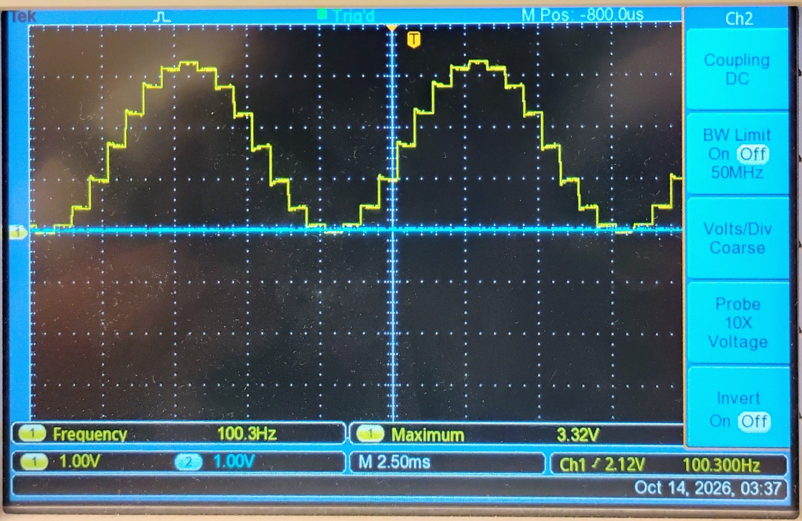
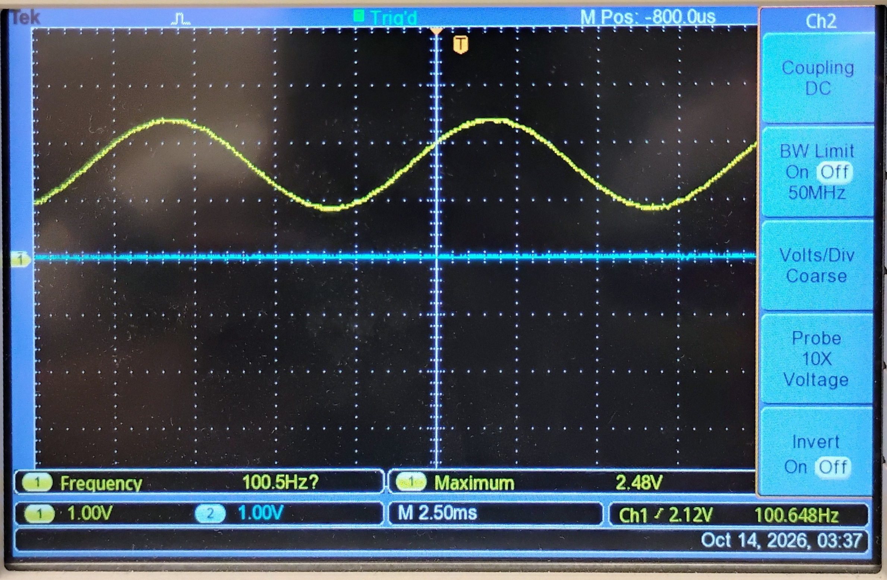

# Lab 2.1 – R-2R DAC Waveform Generator

Generates sawtooth, triangle, and sine waveforms with an 8-bit R-2R resistor-ladder DAC driven from Port 4 of the MSP432P401R, with real-time control over amplitude and frequency from the LaunchPad's onboard switches.

## Wiring
| MSP432 | Connects to |
| :--- | :--- |
| P4.0 – P4.7 | R-2R resistor ladder inputs (8-bit value) |
| Ladder output (DAC-VOUT) | Oscilloscope / RC filter input |
| P1.1, P1.4 | Onboard switches — amplitude & frequency select |

## Parts

| Part | File | What it adds |
| :--- | :--- | :--- |
| **A / B** | [`main_A_B_sawtooth_triangle.c`](./src/main_A_B_sawtooth_triangle.c) | Sawtooth or triangle wave from an unclocked software counter in the main loop, selected at compile time via `#define SAWTOOTH` / `#define TRIANGLE`. An optional `#define TEST` prints each count (leave it off when measuring, since `printf` slows the output) |
| **C** | [`main_C_sine_lookup.c`](./src/main_C_sine_lookup.c) | Sine wave from a 16-entry lookup table, also unclocked in the main loop |
| **D** | [`main_D_sine_timer32_isr.c`](./src/main_D_sine_timer32_isr.c) | Same lookup table, now clocked out by a Timer32_0 ISR at a fixed rate for a controlled 100Hz sine wave |
| **E** | [`main_E_sine_switch_control.c`](./src/main_E_sine_switch_control.c) | Onboard switches (P1.1, P1.4) scale frequency (100Hz/50Hz) and amplitude (100%/50%) live, by dividing the ISR's step rate and the table's output value respectively |
| **F** | *(hardware only, no code)* | Single-pole RC filter (R=10kΩ, C=0.1–0.15µF) smooths the stair-step DAC output into a continuous analog waveform |

## Key calculations
Parts A–C are unclocked (no timer), so their output rate depends on the CPU's loop speed rather than a fixed clock — no fixed frequency to calculate.

Part D onward uses Timer32_0 with SMCLK = 3MHz and a period register of 1874 (i.e. 1875 clock cycles):
- ISR rate = 3,000,000 Hz / 1875 = **1600 Hz**
- Sine table has 16 entries, so one full cycle = 16 ISR ticks → sine frequency = 1600 / 16 = **100 Hz** ✅ matches the lab target

Part E divides that same 1600Hz step rate by 2 when SW1 is pressed → **50 Hz** sine, and divides the output *value* by 2 when SW2 is pressed → roughly half amplitude.

## Results
Scope captures of the 100 Hz sine (Timer32 ISR, 16-entry table), 1 V/div, 2.5 ms/div.

| Capture | Scope reading | What it shows |
| :--- | :--- | :--- |
| Raw ladder output (`r2r_100hz_raw.jpg`) | 100.3 Hz, max 3.32 V | 16-step staircase spanning about 0 to 3.3 V |
| After RC filter, R = 10 kΩ (`r2r_100hz_filtered.jpg`) | 100.5 Hz, max 2.48 V | Smooth sine with about half the raw swing |

The filtered swing is about half the raw swing. A 10 kΩ filter with 0.1–0.15 µF alone would only reduce a 100 Hz signal to roughly 0.73–0.85 of its raw swing, so the extra loss is probably the ladder's output impedance (about its R value) adding to the filter resistor.

## Files
- [`src/main_A_B_sawtooth_triangle.c`](./src/main_A_B_sawtooth_triangle.c)
- [`src/main_C_sine_lookup.c`](./src/main_C_sine_lookup.c)
- [`src/main_D_sine_timer32_isr.c`](./src/main_D_sine_timer32_isr.c)
- [`src/main_E_sine_switch_control.c`](./src/main_E_sine_switch_control.c)
