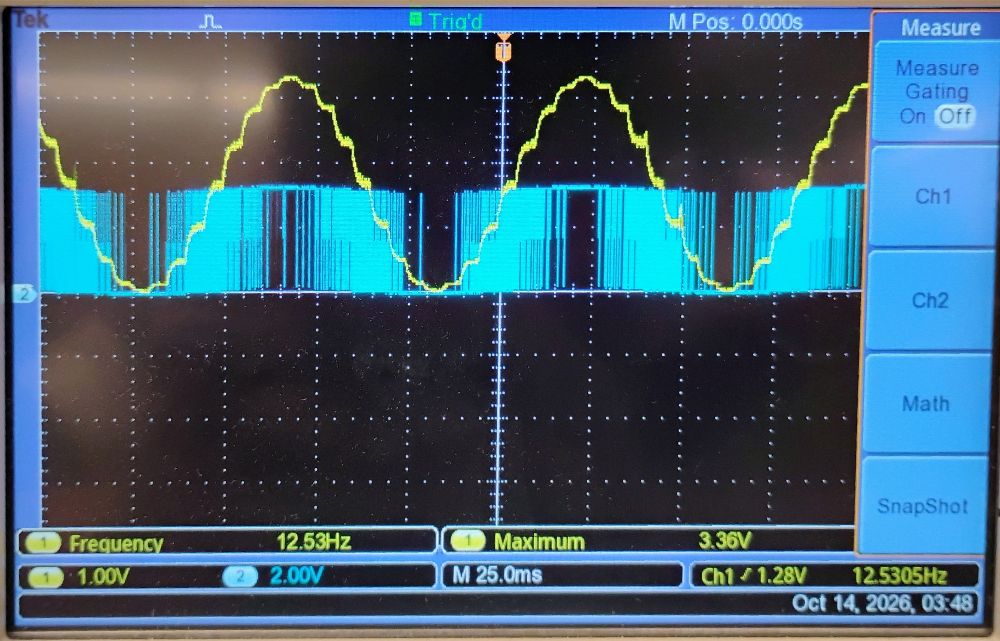
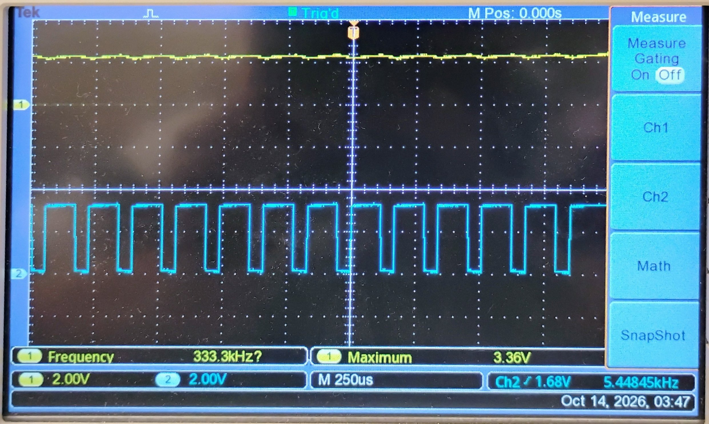

# Lab 3.1 – PWM DAC

Builds on Lab 2.1 by replacing the R-2R ladder with the MSP432's TimerA PWM generator, filtered through an RC low-pass to reconstruct sawtooth and sine waveforms from a switching output. SMCLK (TimerA's clock) runs at 3 MHz throughout.

## Wiring
| MSP432 | Connects to |
| :--- | :--- |
| P2.4 (TA0.1 PWM output) | Oscilloscope, then RC filter input |

## Parts

| Part | File | What it adds |
| :--- | :--- | :--- |
| **A** | [`main_A_pwm_33pct.c`](./src/main_A_pwm_33pct.c) | TimerA_0 configured for PWM at a fixed 33% duty cycle |
| **B** | [`main_B_pwm_sawtooth.c`](./src/main_B_pwm_sawtooth.c) | Sawtooth wave: a Timer32 interrupt every 5ms ramps TimerA's CCR1 compare value from 0→255, producing a stepped sawtooth envelope on the PWM output |
| **C** | [`main_C_pwm_sine.c`](./src/main_C_pwm_sine.c) | Sine wave: the same Timer32 ISR instead replays the Lab 2.1 16-entry lookup table into CCR1 |
| **D** | *(hardware only, no code)* | RC filter (R=10kΩ, C=0.1µF) applied to the raw PWM output; raw vs. filtered waveform compared on the scope |

## Key calculations
All parts run TimerA off SMCLK = 3MHz.

**Part A** — CCR0 = 14999 (15,000 counts per period), CCR1 = 4950:
- PWM frequency = 3,000,000 / 15,000 = **200 Hz**
- Duty cycle = 4950 / 15000 = **33%** ✅ matches the lab target

**Part B** — CCR0 = 255 with a /2 prescaler, Timer32 period register = 14999 (15,000 cycles):
- PWM carrier frequency = 3,000,000 / 2 / 256 ≈ **5859 Hz**
- Timer32 ISR rate = 3,000,000 / 15,000 = **200 Hz** (5 ms period, as specified)
- CCR1 is stepped by 1 each ISR and wraps every 256 steps → sawtooth envelope frequency = 200 / 256 ≈ **0.78 Hz**

**Part C** — same PWM/Timer32 setup as Part B, but CCR1 is loaded from a 16-entry sine table each ISR tick:
- Sine frequency = 200 Hz ISR rate / 16 samples = **12.5 Hz** ✅ matches the lab target

## Results
Scope captures of the 12.5 Hz sine. Cyan is the raw PWM pin (P2.4), yellow is the RC-filtered output.

| Capture | Scope reading | What it shows |
| :--- | :--- | :--- |
| 12.5 Hz sine (`pwm_12_5hz_raw_vs_filtered.jpg`) | Filtered: 12.53 Hz, max 3.36 V (raw at 2 V/div, 25 ms/div) | Matches the 12.5 Hz calculation. At this timebase the raw PWM reads as a solid band, and the filtered output shows the 16-step staircase from the 200 Hz update rate |
| Zoomed in (`pwm_12_5hz_zoom.jpg`) | Raw pulse period ≈ 170 µs (≈ 5.9 kHz), max 3.36 V (2 V/div, 250 µs/div) | Individual PWM pulses (cyan) with the filtered output (yellow) nearly flat, showing how little ripple gets through the RC filter |

## Files
- [`src/main_A_pwm_33pct.c`](./src/main_A_pwm_33pct.c)
- [`src/main_B_pwm_sawtooth.c`](./src/main_B_pwm_sawtooth.c)
- [`src/main_C_pwm_sine.c`](./src/main_C_pwm_sine.c)
