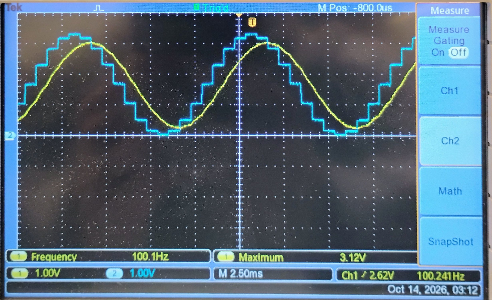
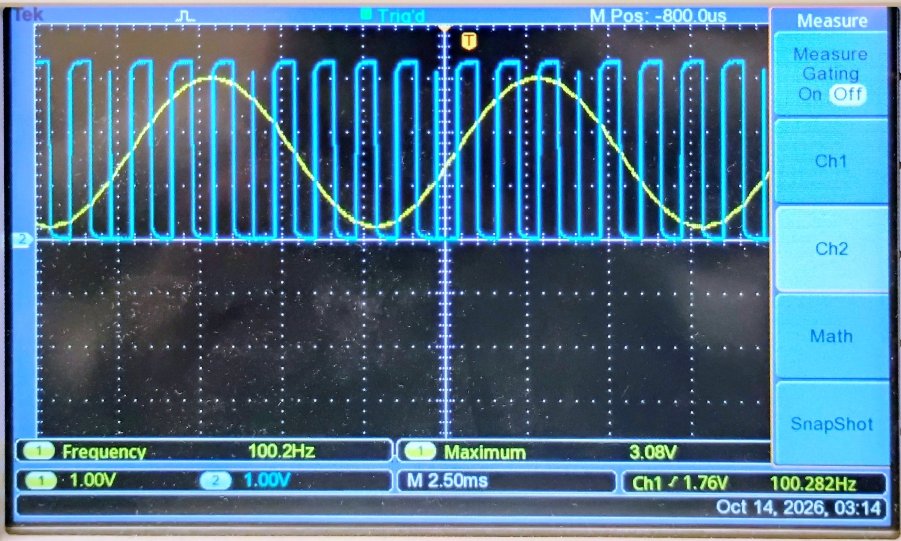

# Lab 4.1 – SPI DAC (MCP4901)

Drives a **Microchip MCP4901 8-bit SPI DAC** from the MSP432P401R using the **eUSCI_B0** module in SPI master mode. Unlike Labs 2.1 and 3.1, which drive the output with GPIO or PWM, each sample is sent to the DAC over a serial bus, with /CS and /LDAC toggled by GPIO each transfer.

## Wiring
| MCP4901 pin | MSP432 | Notes |
| :--- | :--- | :--- |
| VDD (1) | 3.3V | |
| /CS (2) | P2.6 | GPIO, driven low during each transfer |
| SCK (3) | P1.5 (UCB0CLK) | SPI clock |
| SDI (4) | P1.6 (UCB0SIMO / MOSI) | DAC is write-only |
| /LDAC (5) | P2.7 | GPIO, pulsed low then high to latch the new output |
| VREF (6) | 3.3V | |
| VSS (7) | GND | |
| VOUT (8) | Oscilloscope / LPF for sin | |

## Parts

| Part | File | What it covers |
| :--- | :--- | :--- |
| **A** | *(documentation only, no code)* | Walkthrough of the provided MCP4901 example: SPI setup, /CS and /LDAC timing, macros, clock rate, and the bits in the 16-bit command word |
| **B** | [`main_B_spi_dac_timer32.c`](./src/main_B_spi_dac_timer32.c) | Moves the DAC write into `Write_MCP4901()`, then uses a Timer32 interrupt to toggle the output between ~1.0V and ~2.0V once per second |
| **Extra** | [`main_extra_spi_sine.c`](./src/main_extra_spi_sine.c) | Not part of the lab. Same SPI driver, but writes a 16-entry sine table at 100Hz from the Timer32 ISR to match the other DACs |

## MCP4901 command word
Each sample is a 16-bit word sent MSB first as two bytes while /CS is low. Bits are numbered in the order they are clocked out. Field meanings are from the MCP4901/4911/4921 datasheet (Microchip DS22248A).

| Bit | 15 | 14 | 13 | 12 | 11 – 4 | 3 – 0 |
| :--- | :---: | :---: | :---: | :---: | :---: | :---: |
| Field | 0 | BUF | /GA | /SHDN | D7 – D0 | X |
| Meaning | 0 = write to DAC | 1 = buffered VREF input | 1 = 1× gain, 0 = 2× gain | 1 = active, 0 = shutdown | 8-bit DAC value | Don't care |

How the code builds it (`Write_MCP4901()`):
- Byte 1 = `(DAC_CONFIG_BITS << 4) | (value >> 4)`, which is the config bits followed by D7–D4
- Byte 2 = `value << 4`, which is D3–D0 followed by four don't-care zeros
- /CS goes low before the first byte and high after the second, then /LDAC is pulsed low and high to latch the new value onto VOUT

Example with `DAC_CONFIG_BITS = 0b0111` (BUF = 1, 1× gain, active):

| Output | DAC value | Byte 1 | Byte 2 |
| :--- | :--- | :--- | :--- |
| ~1.0 V | `0x4E` | `0x74` | `0xE0` |
| ~2.0 V | `0x9B` | `0x79` | `0xB0` |

## Key calculations
Part B assumes VREF = 3.3V and 1× output gain (GA = 1, command nibble `0b0111`).

- Output voltage: V_OUT = V_REF × D / 256
- Low level, DAC = 0x4E (78): 3.3 × 78 / 256 ≈ **1.005 V**
- High level, DAC = 0x9B (155): 3.3 × 155 / 256 ≈ **1.998 V**
- Step size = 3.3 / 256 ≈ 12.9 mV, so exactly 1.0 V and 2.0 V aren't reachable

Gain bit: with /GA = 0 (`0b0101`) the output doubles, so the same two values would give about 2.0 V and 4.0 V. The 4.0 V is above the 3.3 V supply, so that level would clip at the rail.

Part B timing: Timer32 counts 2,999,999 → 3,000,000 cycles ÷ 3 MHz MCLK = **1.000 s** per toggle.

Extra sine timing: ISR every 1,875 cycles → 3,000,000 ÷ 1,875 = **1600 Hz**, ÷ 16 samples = **100 Hz**. Each 16-bit SPI write takes 32 µs at 500kHz, well inside the 625 µs sample period.

## Results
Scope captures of the 100 Hz sine from the MCP4901. Yellow is the RC-filtered output.

| Capture | Scope reading | What it shows |
| :--- | :--- | :--- |
| Raw vs. filtered (`spi_100hz_raw_vs_filtered.jpg`) | Filtered: 100.1 Hz, max 3.12 V (1 V/div, 2.5 ms/div) | Raw MCP4901 staircase (cyan) vs. filtered output (yellow). The filtered swing is about 85% of the raw swing, close to the RC prediction at 100 Hz, and the filtered trace lags the steps |
| Filtered output with SPI signal (`spi_100hz_filtered_with_spi_signal.jpg`) | Filtered: 100.2 Hz, max 3.08 V (1 V/div, 2.5 ms/div) | Filtered sine (yellow) with an SPI signal (cyan) on channel 2, showing one transfer per 625 µs sample period |

## Files
- [`src/main_B_spi_dac_timer32.c`](./src/main_B_spi_dac_timer32.c)
- [`src/main_extra_spi_sine.c`](./src/main_extra_spi_sine.c)
